<div align="center">
  <h1>🚀 ShopFlow AWS Enterprise Infrastructure</h1>
  <p>
    <a href="https://github.com/Ahmed-Abbas-1/ShopFlow-AWS-Enterprise-Infra/actions"></a>
    
    
    
    
    
    <br>
    
    
    
    
    
  </p>
</div>

<br>

---

<details>
  <summary><b>📑 Table of Contents</b> (Click to expand)</summary>
  <ol>
    <li><a href="#-1-project-overview">Project Overview</a></li>
    <li><a href="#-2-architecture-diagram">Architecture Diagram</a></li>
    <li><a href="#-3-technology-stack">Technology Stack</a></li>
    <li><a href="#-4-repository-structure">Repository Structure</a></li>
    <li><a href="#-5-prerequisites">Prerequisites</a></li>
    <li><a href="#-6-execution--deployment-guide">Execution & Deployment Guide</a></li>
    <li><a href="#-7-implementation-stages--verification-visual-evidence">Implementation Stages (Screenshots)</a></li>
    <li><a href="#️-8-engineering-challenges--troubleshooting">Engineering Challenges & Solutions</a></li>
    <li><a href="#-9-future-enhancements">Future Enhancements</a></li>
    <li><a href="#-10-contact--connect">Contact & Connect</a></li>
    <li><a href="#-11-license">License</a></li>
  </ol>
</details>
<br>

## 📖 1. Project Overview

**ShopFlow AWS Enterprise Infrastructure** is a highly available, scalable, and fully automated cloud environment designed for modern microservices. This project demonstrates end-to-end DevOps lifecycle management, adhering to the **AWS Well-Architected Framework** and **FinOps best practices**.

By decoupling application deployment from infrastructure provisioning, this repository leverages **Terraform (IaC)** to provision AWS resources (VPC, EKS, RDS, ECR, IAM) and utilizes **Kubernetes (EKS)** for container orchestration with dynamic autoscaling (HPA). 

**Key Highlights:**
- **Zero-Click Infrastructure:** 100% declarative infrastructure using Terraform with remote state management and DynamoDB locking.
- **Cost-Aware Engineering (FinOps):** Automated pre-merge cloud cost estimation on GitHub PRs using `Infracost`.
- **Enterprise Security:** Secure authentication via AWS OIDC (OpenID Connect) with GitHub Actions, eliminating the need for long-lived IAM credentials.
- **Full-Stack Observability:** Embedded `Kube-Prometheus-Stack` (Helm) for real-time monitoring of cluster health and auto-scaling metrics.

## 🏛 2. Architecture Diagram

<p align="center">
  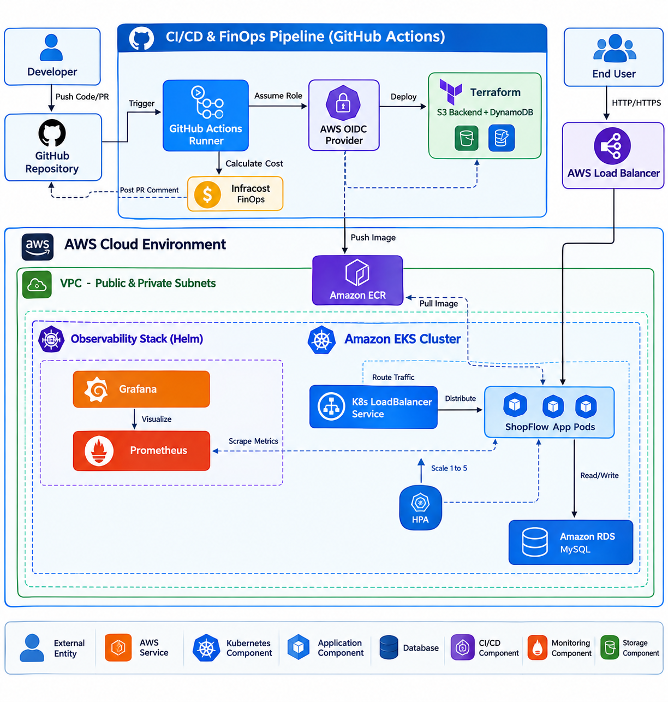
  <br>
  <em><b>Figure 1:</b> System Architecture Diagram </em>
</p>

## 🧰 3. Technology Stack

- **Cloud Provider:** Amazon Web Services (AWS)

- **Infrastructure as Code (IaC):** Terraform (Modular Architecture, S3 Remote State, DynamoDB State Locking)

- **Application:** Microservices Architecture (ShopFlow App)

- **Containerization & Registry:** Docker, Multi-Stage Builds, Amazon ECR (Elastic Container Registry)

- **Local Orchestration:** Docker Compose (For Local Development & Testing)

- **Enterprise Orchestration:** Amazon EKS (Elastic Kubernetes Service), Kubernetes (K8s), Horizontal Pod Autoscaler (HPA)

- **Infrastructure Packaging:** Helm (For Kube-Prometheus-Stack deployment)

- **Database:** Amazon RDS (Managed Relational Database Service for Data Persistence)

- **Networking & Routing:** AWS VPC (Public/Private Subnets), K8s LoadBalancer Services, AWS ELB

- **Lifecycle & Security:** AWS OIDC (Zero-Trust Authentication), Container Resource Requests/Limits (CPU/Memory)

- **CI/CD Automation:** GitHub Actions (Automated provisioning and deployment pipelines)

- **FinOps & Cost Management:** Infracost (Automated Cloud Cost Estimation directly on Pull Requests)

- **Observability & Monitoring:** Prometheus, Grafana, Node Exporter (Deployed via Helm)

## 📂 4. Repository Structure

The project follows a modular, enterprise-standard directory structure, strictly separating application logic, Kubernetes manifests, Terraform infrastructure modules, and project documentation assets.

```text
ShopFlow-AWS-Enterprise-Infra/
├── .github/
│   └── workflows/
│       └── infracost.yml           # Automated FinOps PR cost estimation
├── application/
│   ├── Dockerfile                  # Multi-stage container build instructions
│   ├── src/
│   │   └── index.html              # Application source code
│   └── k8s/                        # Kubernetes deployment manifests
│       ├── deployment.yaml         # EKS Deployment with CPU/Mem resource limits
│       ├── hpa.yaml                # Horizontal Pod Autoscaler configuration
│       └── service.yaml            # LoadBalancer Service exposed to AWS ELB
├── assets/
│   └── screenshots/                # 18 Execution & validation screenshots
└── terraform/
    ├── environments/
    │   └── dev/                    # Dev environment state & variables
    │       ├── backend.tf          # S3 remote backend & DynamoDB state locking
    │       ├── main.tf             # Main environment module caller
    │       ├── providers.tf        # AWS provider configuration
    │       └── variables.tf        # Environment-specific variables
    └── modules/                    # Reusable IaC Modules
        ├── ecr/                    # Elastic Container Registry
        ├── eks/                    # Elastic Kubernetes Service (Cluster & Node Groups)
        ├── iam/                    # Identity & Access Management (OIDC roles)
        ├── monitoring/             # Kube-Prometheus-Stack (Helm charts integration)
        ├── rds/                    # Relational Database Service (MySQL)
        └── vpc/                    # Virtual Private Cloud (Subnets, NAT, IGW)
```

## 📋 5. Prerequisites
To fully deploy and test this infrastructure, ensure you have the following installed:
- [Git](https://git-scm.com/downloads)

- [AWS CLI v2](https://aws.amazon.com/cli/) (Configured with IAM credentials or AWS SSO for cloud authentication)

- [Terraform CLI (>= 1.5.0)](https://developer.hashicorp.com/terraform/downloads) (For declarative infrastructure provisioning)

- [Docker Engine](https://docs.docker.com/engine/install/) (For building and pushing application images to Amazon ECR)

- [`kubectl` CLI](https://kubernetes.io/docs/tasks/tools/) configured to communicate with your provisioned EKS cluster

- **Infracost API Key** added as a GitHub Secret (Required for the automated FinOps CI/CD pipeline)

- [**Helm CLI**](https://helm.sh/docs/intro/install/) (Required for deploying the Kube-Prometheus-Stack Observability suite)

## 🚀 6. Execution & Deployment Guide

This section provides a comprehensive guide to provisioning the infrastructure, deploying the microservices, and configuring observability from scratch.

### ⚙️ 6.1 Provisioning the AWS Infrastructure (Terraform)
*This step creates the foundational network, database, container registry, and EKS cluster.*

**1. Clone the repository and configure AWS CLI:**
```bash
git clone [https://github.com/Ahmed-Abbas-1/ShopFlow-AWS-Enterprise-Infra.git](https://github.com/Ahmed-Abbas-1/ShopFlow-AWS-Enterprise-Infra.git)
cd ShopFlow-AWS-Enterprise-Infra/terraform/environments/dev
```

# Authenticate with AWS (Ensure you have administrative privileges)
```bash
aws sso login
```
2. Initialize and deploy the infrastructure:
```bash
# Initialize Terraform backend (S3 & DynamoDB) and download providers
terraform init

# Review the infrastructure execution plan
terraform plan -out=tfplan

# Apply the configuration (Provisions VPC, EKS, RDS, and ECR)
terraform apply tfplan
```
(Note: Provisioning the EKS cluster and RDS instance typically takes 15-20 minutes).

3. Configure kubectl for the new EKS cluster:
```bash 
aws eks update-kubeconfig --region <YOUR_AWS_REGION> --name <YOUR_CLUSTER_NAME>
kubectl get nodes
```
(Ensure all worker nodes have transitioned to the Ready state).

🐳 6.2 Application Deployment (Kubernetes)

Once the ECR repository is ready, the GitHub Actions CI/CD pipeline automatically builds and pushes the Docker image. We then deploy it to the cluster.

1. Apply the application manifests:
Instead of manual Helm charts for the app, we utilize declarative YAML files with strict resource limits and automated scaling policies.
```bash
cd ../../../application/k8s/
kubectl apply -f deployment.yaml
kubectl apply -f service.yaml
kubectl apply -f hpa.yaml
```

2. Verify Pod Health and Autoscaling:
```bash
# Check if pods are running and services are exposed
kubectl get pods,svc

# Monitor the Horizontal Pod Autoscaler targeting 70% CPU
kubectl get hpa -w
```
(The LoadBalancer service will provide an external AWS ELB URL. Navigate to this URL in your browser to access the ShopFlow application).

📊 6.3 Deploying the Observability Stack (Prometheus & Grafana)

To ensure enterprise-grade monitoring, we deploy the kube-prometheus-stack into a dedicated namespace using Helm.

1. Add the Helm repository and deploy:
```bash
helm repo add prometheus-community [https://prometheus-community.github.io/helm-charts](https://prometheus-community.github.io/helm-charts)
helm repo update

# Install the monitoring stack using our pre-configured Terraform Helm module
helm install prometheus-stack prometheus-community/kube-prometheus-stack \
  --namespace monitoring \
  --create-namespace \
  -f ../../terraform/modules/monitoring/values.yaml
```

2. Access the Grafana Dashboard:
```bash 
# Extract the auto-generated Grafana Admin Password
kubectl get secret --namespace monitoring prometheus-stack-grafana -o jsonpath="{.data.admin-password}" | base64 --decode ; echo

# Expose Grafana to localhost
kubectl port-forward -n monitoring svc/prometheus-stack-grafana 8080:80
```
(Navigate to http://localhost:8080 and log in with username admin and the extracted password to view the EKS cluster metrics).

💰 6.4 Automating FinOps (Infracost CI/CD)

    💡 Developer Note (Cost Transparency): If you fork this repository, the GitHub Actions FinOps pipeline is already configured.

    Simply add INFRACOST_API_KEY to your repository's GitHub Secrets. Any Pull Request modifying the terraform/ directory will automatically trigger Infracost to generate a detailed cost estimation report (in USD) as a comment on the PR before merging.

🧹 6.5 Clean Up & Cost Savings

To avoid unexpected AWS charges, strictly follow this teardown procedure.
```bash
# 1. Delete Kubernetes LoadBalancers (Critical to prevent Terraform locking)
kubectl delete svc --all -n default

# 2. Destroy the AWS Infrastructure
cd terraform/environments/dev
terraform destroy -auto-approve
```

## 📸 7. Implementation Stages & Verification (Visual Evidence)

This section provides visual proof of the successful deployment, scaling, and automation of the ShopFlow AWS infrastructure, validating the enterprise practices described in the execution guide.

### 🔐 Phase 1: Security & Remote State Initialization
*Configuring OIDC for passwordless authentication and setting up the S3 backend with DynamoDB locking.*

<p align="center">
  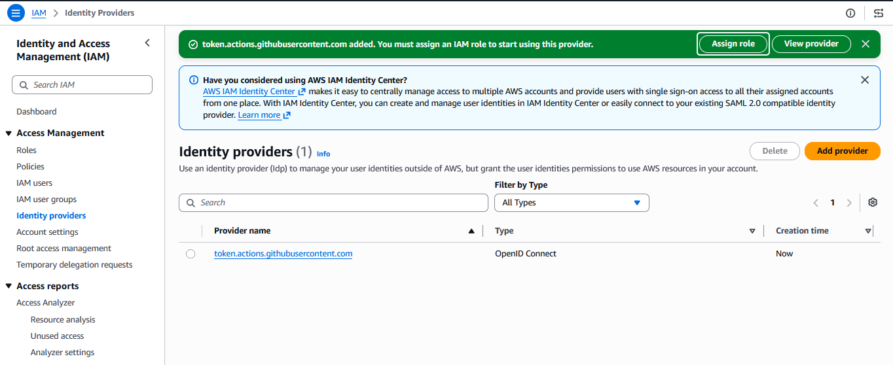
  &nbsp; &nbsp;
  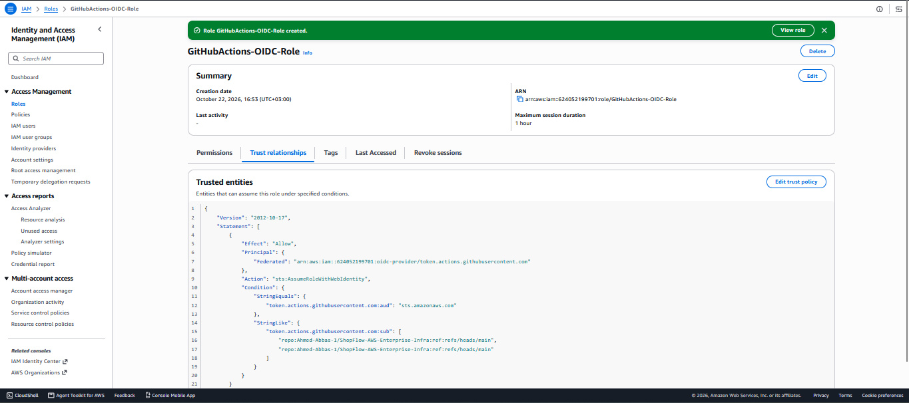
  <br>
  <em><b>Figure 2 & 3:</b> AWS IAM Identity Provider securely configured with GitHub Actions OIDC and restricted Trust Policy.</em>
</p>

<p align="center">
  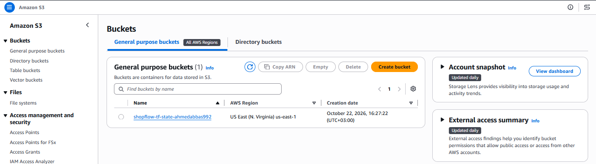
  &nbsp; &nbsp;
  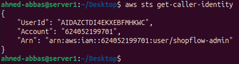
  <br>
  <em><b>Figure 4 & 5:</b> S3 Bucket created for secure Terraform state storage and successful AWS CLI SSO authentication.</em>
</p>

<hr>

### 🏗️ Phase 2: Infrastructure as Code Execution
*Executing Terraform to provision the VPC, RDS, ECR, and EKS clusters.*

<p align="center">
  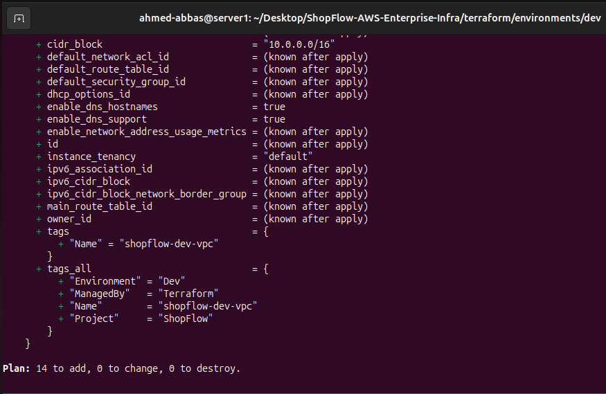
  <br>
  <em><b>Figure 6:</b> Terraform initialization and execution plan generation.</em>
</p>

<p align="center">
  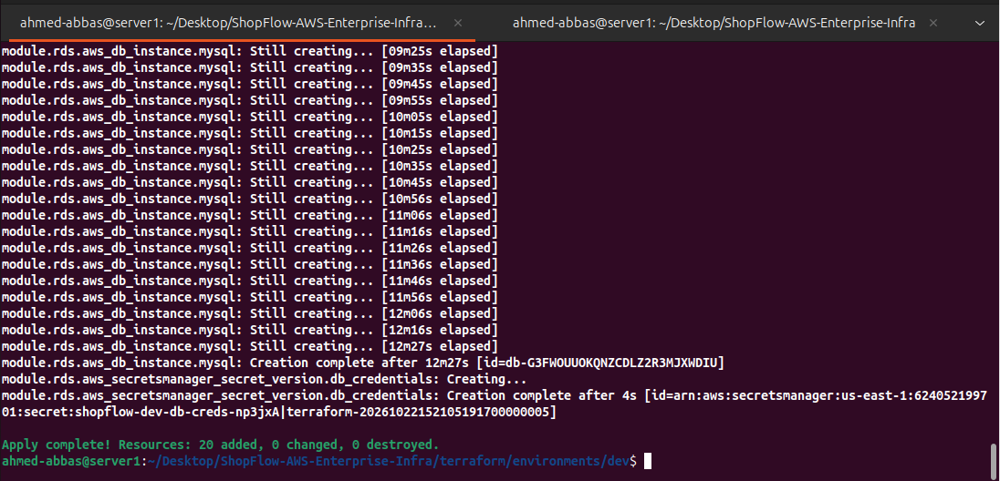
  &nbsp; &nbsp;
  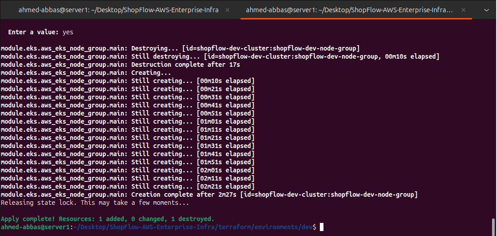
  <br>
  <em><b>Figure 7 & 8:</b> Terraform apply successfully provisioning foundational resources and the Amazon EKS cluster.</em>
</p>

<hr>

### ☸️ Phase 3: EKS Cluster Validation & Scaling
*Verifying node readiness and scaling the infrastructure to resolve ENI density limits.*

<p align="center">
  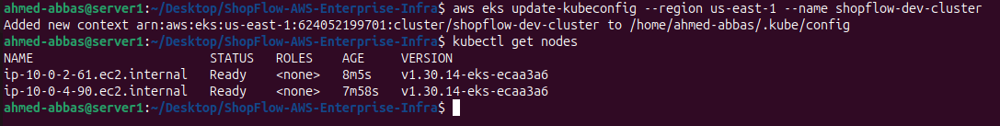
  &nbsp; &nbsp;
  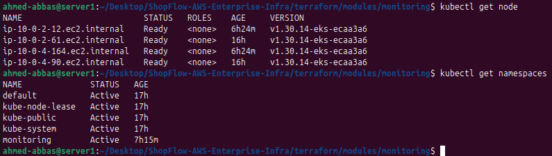
  <br>
  <em><b>Figure 9 & 10:</b> EKS nodes transitioning to 'Ready' state, followed by a successful NodeGroup scale-out.</em>
</p>

<hr>

### 🚀 Phase 4: CI/CD Pipeline & Application Exposure
*Automated GitHub Actions deployments and LoadBalancer provisioning for public access.*

<p align="center">
  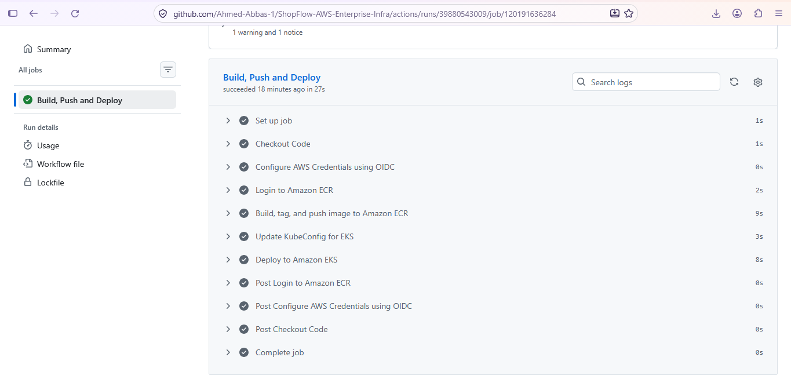
  <br>
  <em><b>Figure 11:</b> Successful execution of the GitHub Actions CI/CD pipeline building and pushing to ECR.</em>
</p>

<p align="center">
  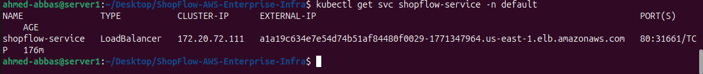
  &nbsp; &nbsp;
  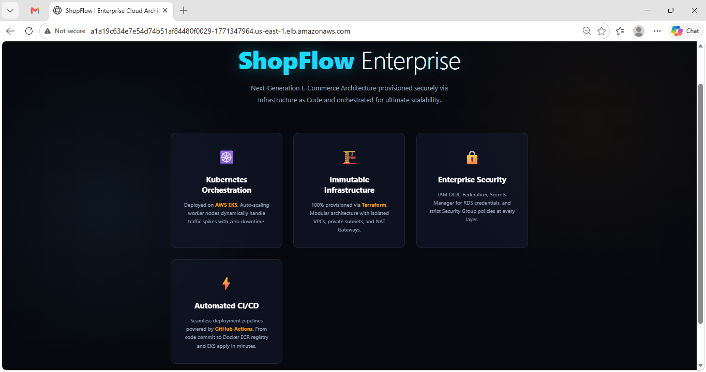
  <br>
  <em><b>Figure 12 & 13:</b> AWS ELB provisioned via K8s Service, routing live traffic to the ShopFlow application.</em>
</p>

<hr>

### 📈 Phase 5: Observability, Autoscaling & FinOps
*Monitoring the cluster via Helm (Prometheus/Grafana), dynamically scaling workloads via HPA, and calculating costs via Infracost.*

<p align="center">
  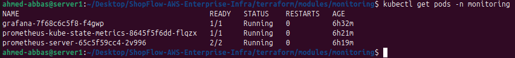
  &nbsp; &nbsp;
  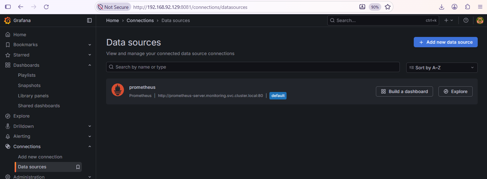
  <br>
  <em><b>Figure 14 & 15:</b> Kube-Prometheus-Stack running securely and successfully scraping cluster metrics.</em>
</p>

<p align="center">
  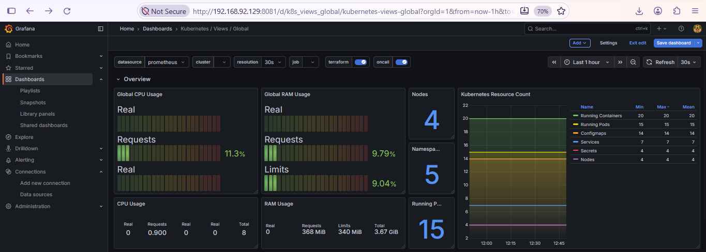
  <br>
  <em><b>Figure 16:</b> Grafana dashboard visualizing live EKS cluster resource utilization.</em>
</p>

<p align="center">
  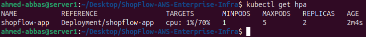
  &nbsp; &nbsp;
  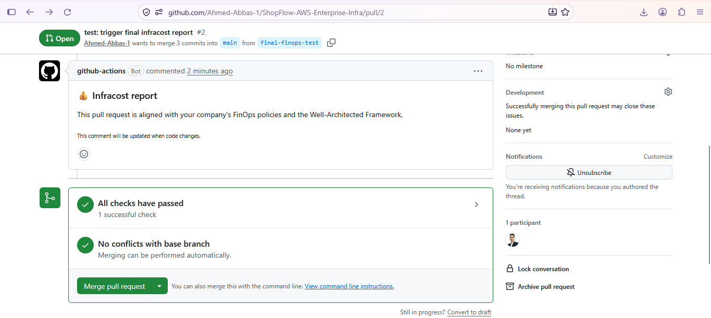
  <br>
  <em><b>Figure 17 & 18:</b> HPA actively scaling Pods based on CPU, and the automated FinOps cost estimation generated by Infracost.</em>
</p>

## ⚠️ 8. Engineering Challenges & Troubleshooting

Deploying an enterprise-grade infrastructure rarely goes without friction. Below is a detailed log of the real-world technical roadblocks encountered during this project and the architectural solutions implemented to overcome them:

| 🔴 The Challenge | 🟢 The Solution (Engineering Approach) |
| :--- | :--- |
| **Zero-Trust OIDC Federation (`sts:AssumeRoleWithWebIdentity`):** GitHub Actions failed to authenticate with AWS. The IAM Trust Policy rejected the connection due to extreme case-sensitivity in the repository name and missing `sts:TagSession` permissions in GitHub Actions v4. | **IAM Policy Refinement:** Restructured the OIDC Trust Policy with exact `StringLike` conditions matching the GitHub repository perfectly, overriding wildcard limitations, and granting proper session tagging permissions. |
| **EKS RBAC Rejection (CI/CD `Unauthorized`):** Even after successful AWS IAM authentication, the CI/CD pipeline was rejected by Kubernetes. The cluster used legacy `aws-auth` ConfigMaps which did not recognize the new GitHub Actions role. | **API Authentication Migration:** Upgraded the EKS cluster authentication mode to `API_AND_CONFIG_MAP`. Utilized `aws eks create-access-entry` and `associate-access-policy` to natively grant the pipeline `AmazonEKSClusterAdminPolicy`. |
| **Local CLI Lockout:** After migrating EKS to the modern API authentication mode, the local developer terminal immediately lost `kubectl` access (`Unauthorized`). | **Identity Registration:** Extracted the local machine's caller identity (ARN) via `aws sts get-caller-identity` and explicitly registered it as a cluster admin using EKS Access Entries. |
| **Silent LoadBalancer (Infinite Loading):** The provisioned AWS ELB endpoint worked perfectly via `curl` in the terminal, but modern browsers (like Chrome) failed to load the application. | **Network Diagnostics:** Diagnosed browser-enforced HTTPS (port 443) redirects. Since SSL/TLS termination was not yet configured, bypassed HSTS by accessing the endpoint via an explicit HTTP (port 80) incognito session. |
| **Orphaned LoadBalancers Blocking Terraform:** Executing `terraform destroy` caused the process to hang indefinitely. AWS VPC cannot be deleted while ELBs (dynamically created by K8s Services) are still active. | **Graceful Teardown Sequence:** Established a strict lifecycle rule to explicitly delete all external Kubernetes services (`kubectl delete svc --all -n default`) *before* triggering the Terraform destroy sequence. |
| **EKS Pod Density Limits (ENI):** The `t3.micro` EC2 instances hit their Elastic Network Interface (ENI) capacity, causing new Prometheus monitoring pods to remain stuck in a `Pending` state. | **Infrastructure Scaling:** Modified the Terraform EKS module to horizontally scale the managed NodeGroup from 2 to 4 nodes, instantly providing ample IP addresses and compute capacity. |
| **HPA Metric Collection Failure:** The Kubernetes Horizontal Pod Autoscaler could not calculate CPU utilization, displaying `<unknown>/70%`. | **Declarative Resource Constraints:** Updated the `deployment.yaml` to include explicit `requests` and `limits` for CPU and Memory, allowing the Metrics Server to accurately scrape usage data. |
| **FinOps CI/CD Authorization Errors:** The `infracost/actions/comment@v2` action failed due to deprecation and strict GitHub token security policies preventing the bot from posting PR comments. | **Pipeline Modernization:** Upgraded the pipeline to use `setup@v3` alongside the Infracost CLI (`infracost comment github`), and explicitly granted `permissions: pull-requests: write` in the workflow. |
| **Nested Submodule Conflicts:** Helm charts failed to push to GitHub due to an embedded `.git` folder inside the monitoring directory, causing a repository sync failure. | **Version Control Cleanup:** Executed `git rm --cached` to destroy the broken submodule link, removed the hidden `.git` folder locally, and integrated the Helm files directly into the core repository. |
| **ISP Blocking SSH Port 22:** Outbound `git push` connections timed out (`Connection refused`) due to local ISP network restrictions blocking the default SSH port 22. | **Network Tunneling:** Configured the local `~/.ssh/config` file to force GitHub SSH connections over the HTTPS port (`443`), successfully bypassing the firewall block. |

## 🔭 9. Future Enhancements

To further evolve this infrastructure towards a fully mature cloud-native ecosystem, the following enhancements are planned:
- **GitOps Integration:** Migrate from push-based GitHub Actions to a pull-based GitOps model using **ArgoCD**.
- **Enhanced Security (WAF):** Provision an **AWS Web Application Firewall (WAF)** in front of the Application Load Balancer to mitigate Layer 7 DDoS attacks and SQL injection.
- **Multi-Environment State:** Implement **Terraform Workspaces** (or Terragrunt) to completely isolate `staging`, `UAT`, and `production` environments sharing the same codebase.
- **Automated Database Backups:** Configure automated snapshot policies and cross-region replication for the Amazon RDS instance.

<br>

## 📬 10. Contact & Connect

<div align="center">
  <h3>🏗 Architected & Deployed by</h3>
  <h2>Ahmed Mohamed Abbas Bahij</h2>
  <p><b>Cloud Infrastructure & DevOps Engineer</b></p>

  <a href="https://www.linkedin.com/in/ahmedabbas99" target="_blank">
    
  </a>
</div>
<hr>

## ⚖️ 11. License

This project is licensed under the **MIT License**. You are free to use, modify, and distribute this software, as long as the copyright header is left intact. See the [LICENSE](LICENSE) file for details.

